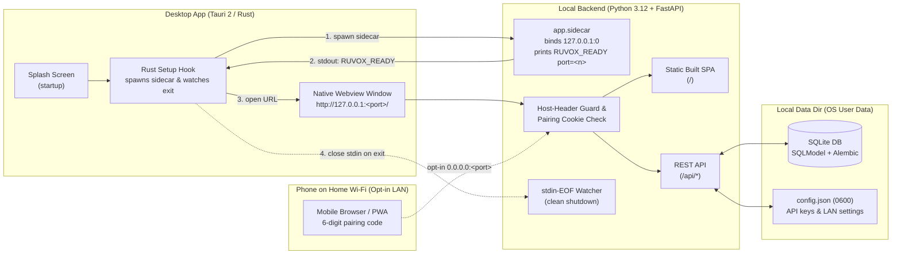
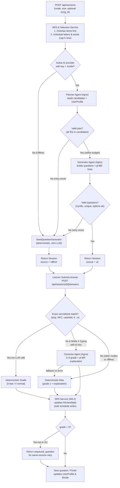
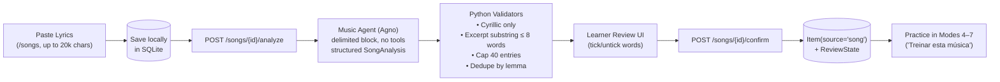

# Ruvox

> **Aprenda russo, do alfabeto às músicas.**

**Ruvox** (*ru* + *vox*, voice) is a **local-first desktop app** that teaches Russian to Brazilian Portuguese speakers—starting from the Cyrillic alphabet and progressing to everyday words and vocabulary extracted from song lyrics you paste in.

It runs entirely on your computer: a lightweight **Tauri 2** window backed by a local **Python / FastAPI** sidecar and a **SQLite** database. No cloud backend, no accounts, and no subscription required. All 7 game modes work **100% offline** with no API key; when you add an API key (Claude, ChatGPT, or Groq), optional AI agents personalize your study sessions, explain near-miss typed answers in Brazilian Portuguese, and extract study vocabulary from your favorite Russian songs. While the desktop app is open, you can also practice from your **phone over your home Wi-Fi**.

---

## Table of Contents

- [Why Ruvox? (Project Context)](#why-ruvox-project-context)
- [How It Works — Visual Flows & Pipelines](#how-it-works--visual-flows--pipelines)
  - [1. System Architecture & Sidecar Lifecycle](#1-system-architecture--sidecar-lifecycle)
  - [2. Study Session, AI Agents & Offline Fallback Pipeline](#2-study-session-ai-agents--offline-fallback-pipeline)
  - [3. Song Vocabulary Extraction Pipeline](#3-song-vocabulary-extraction-pipeline)
- [Game Modes & Learning Progression](#game-modes--learning-progression)
- [Tech Stack](#tech-stack)
- [Repository Layout](#repository-layout)
- [How to Run](#how-to-run)
  - [Prerequisites](#prerequisites)
  - [Quick Start (Desktop App)](#quick-start-desktop-app)
  - [Fast Frontend Development (Hot Reload)](#fast-frontend-development-hot-reload)
  - [Configuring Optional AI Providers](#configuring-optional-ai-providers)
  - [Quality Checks & Tests](#quality-checks--tests)
  - [Building Installers](#building-installers)
- [Project Status: Done vs. What's Left](#project-status-done-vs-whats-left)
- [Documentation](#documentation)

---

## Why Ruvox? (Project Context)

Learning Russian as a Brazilian Portuguese speaker starts with a specific hurdle: reading Cyrillic comfortably and mapping sounds to familiar Portuguese phonetics (for example, `Привет (pri-VIÉT)` or `Ч` as *"tch, como em tchau"*).

Ruvox is built around five core principles:

- **Local-first & private:** Your progress, settings, and pasted song lyrics stay in your OS user data directory (`~/.local/share/ruvox` on Linux). Nothing is hosted, and no copyrighted lyrics are bundled with the app.
- **Offline-first by design:** Every game mode works with zero API keys. When AI is enabled, every agent call is validated by Python schemas and automatically falls back to deterministic offline logic if the API is slow, down, or returns invalid output.
- **Spaced repetition at the core:** A pure-Python SM-2 engine (`services/srs.py`) is the sole writer of `ReviewState`. AI agents can select and order candidates, but they can never corrupt your review schedule.
- **Short, focused sessions:** 5–10 minute sessions with immediate feedback, in-session requeuing of missed items, streaks, and mastery tracking.
- **Desktop + Phone over LAN:** Because the Python sidecar serves both the API (`/api`) and the built React SPA (`/`), the Tauri window and your phone browser load the exact same app over your local Wi-Fi (opt-in, protected by a 6-digit pairing code).

---

## How It Works — Visual Flows & Pipelines

### 1. System Architecture & Sidecar Lifecycle

When you launch Ruvox, the Rust/Tauri shell starts the Python backend as a sidecar, waits for a stdout handshake with the dynamically allocated port, and then opens the desktop window on that URL. Closing the window closes the sidecar's `stdin`, ensuring no orphan Python processes are left behind.



> **Type-safety pipeline:** Backend Pydantic/FastAPI schemas are the single source of truth. `python -m app.openapi` exports the OpenAPI spec without starting a server, and `openapi-typescript` generates `frontend/src/api/schema.d.ts` (verified in CI).

---

### 2. Study Session, AI Agents & Offline Fallback Pipeline

Each study session starts from your `ReviewState`. If an AI provider is configured, `SessionTeam` orchestrates the **Planner** and **Generator** agents in Python (with a 25 s total budget, at most 2 LLM calls per session, and strict schema validation). If anything fails—or if you are offline—Ruvox seamlessly runs the deterministic path.



---

### 3. Song Vocabulary Extraction Pipeline

Song lyrics are treated as untrusted local-only input. They are wrapped in a delimited prompt block, processed by a tool-less agent, validated in Python, and reviewed by you before entering your study deck.



---

## Game Modes & Learning Progression

Letters are organized into **3 progressive groups**:
1. **Group 1 (5 letters):** Same look and sound as Latin (`А К М О Т`) — unlocked from day one.
2. **Group 2 (7 letters):** Look Latin, sound different (`В Е Н Р С У Х`) — unlocks when ≥ 80% of Group 1 has `repetitions >= 2`.
3. **Group 3 (21 letters):** New Cyrillic letters (`Б Г Д Ё Ж З И Й Л П Ф Ц Ч Ш Щ Ъ Ы Ь Э Ю Я`) — unlocks at ≥ 80% of Group 2.

Seed words (50 everyday words and cognates like `банан`, `метро`, `кофе`, `привет`) unlock automatically as soon as you have practiced every letter in them (`repetitions >= 1`).

| # | Mode | What You Practice | Input | Works Offline? |
| - | ---- | ----------------- | ----- | -------------- |
| 1 | **Letter → Sound** | *"Como se lê «Ч»?"* | Multiple choice | Yes |
| 2 | **Sound → Letter** | *"Qual letra faz «tch»?"* | Multiple choice | Yes |
| 3 | **Word → Meaning** | Read Russian word, pick pt-BR meaning | Multiple choice | Yes |
| 4 | **Typing** | Type Cyrillic (includes on-screen Cyrillic keyboard) | Text input | Yes *(AI explains near misses)* |
| 5 | **Flashcards** | Reveal pronunciation & meaning (*"Sabia / Errei"*) | Flip card | Yes |
| 6 | **Timed Pairs** | Match 6 Cyrillic-to-Portuguese pairs in 60 s | Pair matching | Yes |
| 7 | **Cloze** | Fill the blank in a short excerpt (≤ 8 words) | Choice or text | Yes |

---

## Tech Stack

| Layer | Technologies | Role |
| ----- | ------------ | ---- |
| **Desktop Shell** | Tauri 2, Rust (`tauri-plugin-single-instance`), PyInstaller (one-dir) | Native window, sidecar lifecycle, splash screen, `.deb` & AppImage packaging |
| **Backend** | Python 3.12, FastAPI, Pydantic v2, SQLModel, SQLite, Alembic, Uvicorn, `platformdirs`, `uv` | REST API, static SPA serving, Host/LAN security guard, SM-2 SRS, migrations |
| **AI Agents** | Agno 3.x, Anthropic (`Claude`), OpenAI (`OpenAIChat`), Groq (`Groq`) | Optional multi-provider structured outputs (Planner, Generator, Corrector, Music) + cost/latency logging |
| **Frontend** | React 19, TypeScript, Vite, Tailwind CSS v4, React Router 7, TanStack Query, `openapi-typescript`, Lucide Icons | Mobile-first SPA (360 px+), Cyrillic on-screen keyboard, dark/light theme, PWA manifest |
| **Quality & CI** | `ruff`, `mypy --strict`, `pytest`, `httpx`, `eslint`, `prettier`, `vitest`, Testing Library, `cargo clippy`, GitHub Actions | Automated lint, formatting, strict typing, OpenAPI schema sync check, unit & API tests |

---

## Repository Layout

```text
ruvox/
├── backend/
│   ├── app/
│   │   ├── main.py          # FastAPI app factory, Host guard, static SPA serving
│   │   ├── sidecar.py       # Sidecar entrypoint: port 0, RUVOX_READY handshake, stdin watcher
│   │   ├── config.py        # OS data dir, config.json (0600), env overrides
│   │   ├── db.py            # SQLite engine, Alembic migrations, idempotent seeding
│   │   ├── lan.py           # LAN access, 6-digit pairing & signed session cookies
│   │   ├── api/             # Routers: sessions, progress, stats, settings, songs, backup, lan
│   │   ├── models/          # SQLModel tables & Pydantic request/response schemas
│   │   ├── services/        # SRS (SM-2), selection, questions, answer checker, profile, stats, backup
│   │   ├── agents/          # Single LLM seam (llm.py), providers.py, team.py, planner/generator/corrector/music, prompts/*.md
│   │   └── data/            # alphabet.json (33 letters), words.json (50 seed words)
│   ├── alembic/             # Database migrations
│   └── tests/               # Offline pytest suite (mocked LLM, isolated RUVOX_DATA_DIR)
├── frontend/
│   ├── src/                 # React SPA (Home, Play, Quiz, Alphabet, Songs, Progress, Settings, Pairing)
│   └── scripts/gen-api.sh   # Generates src/api/schema.d.ts from backend OpenAPI
├── src-tauri/               # Tauri 2 Rust shell, splash/error pages, icons, bundle config
├── scripts/                 # build-sidecar.sh (PyInstaller packaging)
├── docs/                    # PLAN.md, user-guide.md (pt-BR), phone.md, llm.md, design-system.md, adr/
├── .github/workflows/       # CI (backend, frontend, tauri) & release builds
└── Makefile                 # dev, dev-backend, build-frontend, build-sidecar, check, release
```

---

## How to Run

### Prerequisites

Primary target is **Linux x86_64**. Make sure you have:

- [`uv`](https://docs.astral.sh/uv/) (manages Python 3.12)
- Node.js 24 & `pnpm` 11
- Stable Rust toolchain (`rustup`)
- `make`
- [Tauri 2 Linux system dependencies](https://v2.tauri.app/start/prerequisites/#linux) (`libwebkit2gtk-4.1-dev`, `libgtk-3-dev`, `librsvg2-dev`, `libayatana-appindicator3-dev`)

### Quick Start (Desktop App)

Run from the repository root:

```sh
uv python install 3.12
uv sync --project backend --frozen
pnpm --dir frontend install --frozen-lockfile
make build-frontend
make dev
```

`make dev` starts Tauri, which spawns the Python sidecar, completes the `RUVOX_READY` handshake, and opens the desktop window. You can start studying immediately with **no API key**.

### Fast Frontend Development (Hot Reload)

When iterating on the UI in a regular browser with Vite HMR (do not run this alongside `make dev`):

```sh
# Terminal 1: backend on fixed port 8000 (Vite proxies /api to it)
make dev-backend

# Terminal 2: Vite dev server with hot reload
pnpm --dir frontend dev
```

### Configuring Optional AI Providers

You can configure **Anthropic (Claude)**, **OpenAI (ChatGPT)**, or **Groq** directly in the app under **Configurações** (keys are saved locally in `<data dir>/config.json` with mode `0600`, and available models are fetched directly from the provider).

Alternatively, environment variables override the saved config (see [`.env.example`](.env.example) and [`docs/llm.md`](docs/llm.md)):

```sh
ANTHROPIC_API_KEY=...        # or OPENAI_API_KEY / GROQ_API_KEY
RUVOX_LLM_PROVIDER=anthropic # anthropic | openai | groq
RUVOX_LLM_MODEL=...          # optional model id override
RUVOX_DATA_DIR=...           # optional custom data directory
```

### Quality Checks & Tests

Run all checks across backend, frontend, and Tauri from the repo root:

```sh
make check
```

Or run each suite individually:

```sh
make check-backend   # ruff check, ruff format --check, mypy (strict), pytest
make check-frontend  # gen:api --check, eslint, prettier, typecheck, vitest, build
make check-tauri     # cargo clippy -D warnings, cargo test
```

To run the opt-in live LLM smoke test against a real API key (never runs in CI):

```sh
cd backend
RUVOX_LIVE_LLM=1 ANTHROPIC_API_KEY=sk-ant-... uv run python -m app.live_smoke
```

### Building Installers

```sh
make release
```

This builds the frontend SPA, freezes the Python sidecar with PyInstaller (`scripts/build-sidecar.sh`), and produces `.deb` and `AppImage` installers under `src-tauri/target/release/bundle/`. Pushing a Git tag (e.g. `v0.1.0`) triggers the same build in GitHub Actions and attaches the installers to a GitHub Release.

---

## Project Status: Done vs. What's Left

The full 5-phase MVP roadmap (`P0-1` through `P4-6`) plus multi-provider AI support is implemented and merged on `main`.

### Completed

- [x] **Phase 0 — Foundation:** Monorepo layout, FastAPI + SQLModel + Alembic backend, 33-letter Cyrillic alphabet seed, React + TypeScript + Tailwind frontend, OpenAPI-to-TS codegen, Tauri 2 shell with sidecar handshake & orphan protection, PyInstaller one-dir sidecar packaging, `Makefile` & 3-job GitHub Actions CI.
- [x] **Phase 1 — Offline Game:** 50 pt-BR seed words, SM-2 spaced repetition engine, content selection with 80% group unlock and letter-based word eligibility, game modes 1–3, session & progress API, mobile-first UI, and Alphabet reference screen.
- [x] **Phase 2 — AI Agents:** Single Agno LLM seam (`StructuredLLM`), per-call token/cost/latency logging (`LLMCall`), Settings API & UI, Planner agent, Generator agent, Corrector agent + Mode 4 typing with on-screen Cyrillic keyboard, `SessionTeam` Python orchestration with 25 s budget & automatic offline fallback, `UserProfile` tracking, and live smoke script.
- [x] **Phase 3 — Songs & Modes 5–7:** Local-only song storage (`/songs`), prompt-injection-safe Music agent with ≤ 8-word excerpt validation and lemma deduplication, vocabulary review/confirm flow, song-focused sessions (*"Treinar esta música"*), Mode 5 (Flashcards), Mode 6 (Timed Pairs), and Mode 7 (Cloze).
- [x] **Phase 4 — Polish & Packaging:** Progress dashboard (mastery buckets, 30-day accuracy chart, streaks), opt-in LAN phone access with 6-digit pairing & automatic sidecar restart, JSON backup export/import & data reset, PWA manifest, `.deb` / AppImage release workflow with single-instance lock, accessibility pass, and pt-BR user guide.
- [x] **Post-MVP Enhancements:** Multi-provider AI support (Anthropic Claude, OpenAI ChatGPT, Groq — all unified through Agno) and a redesigned fluid UI.

### What's Left / Next Steps

- [ ] **Live LLM smoke verification:** Run `python -m app.live_smoke` against real API keys (Claude, OpenAI, Groq) to verify live latency, structured outputs, and cost logging end-to-end.
- [ ] **Real-device LAN & desktop verification:** Verify phone pairing over a real home Wi-Fi network and the automatic LAN-mode sidecar restart inside a packaged Tauri desktop window.
- [ ] **First tagged release (`v0.1.0`) & branch protection:** Decide on repository branch protection and push tag `v0.1.0` to validate the automated `.deb` / AppImage GitHub Release workflow.
- [ ] **Cross-platform builds (future):** Best-effort packaging and testing for Windows and macOS (currently Linux x86_64 first).
- [ ] **Optional future improvements:** Add OpenAI/Groq pricing entries to `PRICES_PER_MTOK` for automatic cost tracking, optional AI-generated cloze sentences beyond stored song excerpts, and richer study feedback (e.g. intro lessons & answer audio).

---

## Documentation

- **Using Ruvox (pt-BR):** [`docs/user-guide.md`](docs/user-guide.md)
- **Phone access over Wi-Fi:** [`docs/phone.md`](docs/phone.md)
- **LLM providers, costs & live smoke test:** [`docs/llm.md`](docs/llm.md)
- **Architecture decisions & full roadmap:** [`docs/PLAN.md`](docs/PLAN.md)
- **Design system:** [`docs/design-system.md`](docs/design-system.md)
- **Architecture Decision Records (ADRs):** [`docs/adr/`](docs/adr/)
